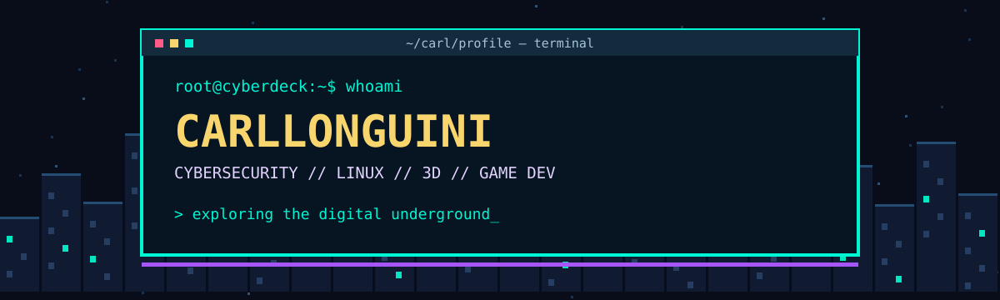

<div align="center">



### `> ACCESS GRANTED // WELCOME TO MY CYBERDECK_`

**Cybersecurity • Linux • 3D Modeling • Game Development**


</div>

## `01 // WHOAMI`

```bash
$ whoami
CarlLonguini

$ cat interests.txt
[+] Cybersecurity e segurança de sistemas
[+] Linux e Kali Linux
[+] Redes, ferramentas e tecnologias de segurança
[+] Blender e modelagem 3D
[+] Criação de jogos e experimentação
[+] Pixel art, estética cyberpunk e games retrô

$ echo "Always learning. Always building."
Always learning. Always building.
```

> Gosto de explorar o lado técnico da computação e o lado criativo dos mundos digitais. Este espaço reúne meus estudos, experiências e projetos em evolução.

## `02 // TECH & TOOLBOX`

<div align="center">

**SECURITY / SYSTEMS**


**CREATIVE / GAME DEV**


</div>

<sub>Ferramentas e áreas de interesse/estudo — não representam certificações ou experiência profissional.</sub>

## `03 // SYSTEM STATS`

<div align="center">


</div>

## `04 // PROJECT ARCHIVE`

| Project | Description | Link |
| :-- | :-- | :-- |
| **Rodmap-localmente-** | Repositório de estudos e projetos | [Open repository](https://github.com/CarlLonguini/Rodmap-localmente-) |

## `05 // ACTIVITY LOG`

<div align="center">


`[ SYSTEM ONLINE ]` · `[ CURIOSITY ENABLED ]` · `[ NEXT LEVEL LOADING... ]`

</div>

---
<div align="center"><sub>⚡ Built with curiosity, terminal vibes & pixel art. // CarlLonguini</sub></div>
