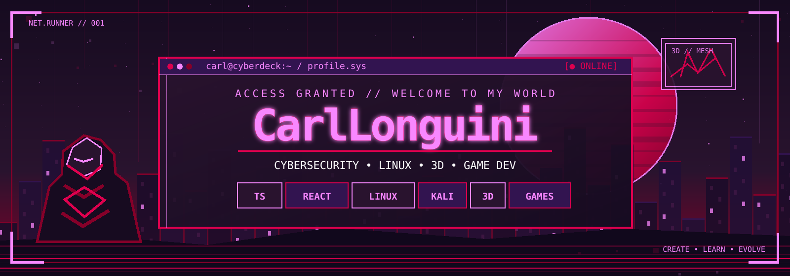

<div align="center">



<br />


**`> connecting technical curiosity with creative worlds_ `**

*Cybersecurity · Linux · Desenvolvimento web · Blender · Modelagem 3D · Game Dev*

</div>

---

## `01 / ABOUT ME` — Quem sou eu?

Olá! Sou **CarlLonguini**. 👋

Gosto de explorar a tecnologia por dois caminhos que se complementam: **entender como sistemas funcionam e como protegê-los** e **criar experiências digitais com código, modelagem 3D e jogos**.

Meu GitHub é um espaço para reunir **projetos reais, estudos e experimentos**. Tenho interesse em **cybersecurity, Linux, Kali Linux, redes e ferramentas de análise de sistemas**. Fora disso, curto mexer no **Blender**, desenvolver ideias para jogos e descobrir novas formas de unir arte e programação.

```console
carl@cyberdeck:~$ cat profile.txt

IDENTIDADE     > Explorador de tecnologia e criação digital
ÁREAS          > Cybersecurity / Linux / Web / 3D / Jogos
CURIOSIDADES   > Sistemas, redes, interfaces e mundos virtuais
FILOSOFIA      > Aprender, construir, testar, melhorar
STATUS         > [ ONLINE ]  aprendendo continuamente...
```

## `02 / CORE INTERESTS` — O que você encontra aqui

<table>
<tr>
<td width="50%" valign="top">

### 🛡️ Cybersecurity & Linux

Interesse em **segurança da informação**, sistemas operacionais e infraestrutura digital.

- Linux e Kali Linux
- Redes e protocolos
- Ambientes de laboratório e análise
- Terminal, Bash e automação
- Fundamentos de segurança e boas práticas

<sub>Uma área de estudo e exploração contínua — não uma declaração de certificações ou atuação profissional.</sub>

</td>
<td width="50%" valign="top">

### 🎮 3D, Blender & Game Development

Meu lado criativo é voltado a **modelagem 3D, estética retrofuturista e criação de jogos**.

- Blender e workflows de modelagem
- Objetos, cenários e assets 3D
- Desenvolvimento e prototipação de jogos
- Visual de jogos retrô e pixel art
- Interfaces e experiências interativas

<sub>Hobbies, experimentos e interesses criativos que quero desenvolver.</sub>

</td>
</tr>
</table>

## `03 / TECH STACK` — Tecnologias e ferramentas

### `[ VERIFIED IN MY REPOSITORIES ]` — Tecnologias presentes nos meus projetos

<div align="center">


<br />


</div>

**Também me interesso por estas ferramentas e áreas:**

<div align="center">


</div>

> **Sobre os ícones:** a primeira coleção representa tecnologias que aparecem no meu código publicado. A segunda mostra áreas e ferramentas que estudo, exploro ou quero aprofundar.

## `04 / FEATURED PROJECT` — Projeto em destaque

<a href="https://github.com/CarlLonguini/Rodmap-localmente-"></a>

### 🗂️ [StudyRoadmap — aplicativo local para organizar estudos](https://github.com/CarlLonguini/Rodmap-localmente-)

Uma aplicação web pessoal para planejar estudos, organizar trilhas de aprendizado e acompanhar o próprio progresso, com interface em português, visual escuro e dados guardados localmente no navegador.

**O que o projeto oferece:**

- **Roadmaps visuais** com tópicos, módulos e dependências;
- **Dashboard** de metas, progresso, tarefas e sessões de estudo;
- **Caderno de notas** e uma área de desenhos interativos;
- **Revisões e histórico** para organizar o que foi aprendido;
- **Backup por exportação/importação**, sem exigir conta ou servidor.

**Stack do projeto:** `React 19` · `TypeScript` · `Vite` · `CSS` · `localStorage`

[**Explorar código e documentação →**](https://github.com/CarlLonguini/Rodmap-localmente-)

## `05 / CURRENT QUESTS` — Em evolução

| Trilha | O que me interessa explorar |
| :--- | :--- |
| `SECURITY.exe` | Fundamentos de cybersecurity, Linux, redes e laboratórios de segurança |
| `SYSTEMS.sh` | Terminal, administração de sistemas, configuração e automação |
| `CREATE.blend` | Modelagem 3D, materiais, objetos e cenários |
| `BUILD.game` | Prototipação, mecânicas de jogos e experiências interativas |
| `DEV.tsx` | Interfaces web, arquitetura frontend e novas ideias de projetos |

<sub>Estas trilhas representam meus interesses, não uma lista de certificações ou projetos já concluídos.</sub>

## `06 / GITHUB ACTIVITY` — Registro de atividade

<div align="center">


<br />


<sub>Os cartões de estatísticas são fornecidos por serviços externos e podem ficar temporariamente indisponíveis.</sub>

</div>

---

<div align="center">

### `[ END OF TRANSMISSION // SIGNAL STILL ACTIVE ]`

**`Learn → Experiment → Build → Repeat`**


<sub>Uma mistura de tecnologia, criatividade e curiosidade. // CarlLonguini</sub>

</div>
